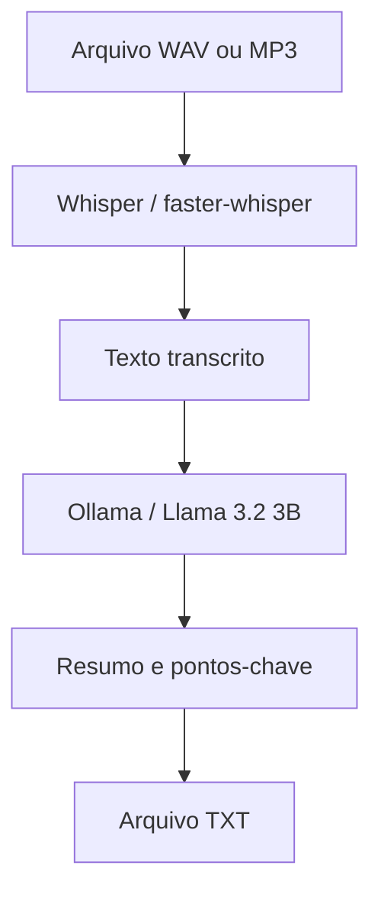

# 🎙️ Transcrição de Áudio com Whisper e Extração de Pontos-Chave com Ollama

Projeto desenvolvido para a **Avaliação Online 7**. A aplicação recebe um áudio `.wav` ou `.mp3`, transcreve com Whisper e utiliza o Ollama para gerar resumo e pontos-chave.

## Objetivo

1. Receber um arquivo de áudio.
2. Transcrever o conteúdo usando Whisper.
3. Enviar o texto transcrito ao Ollama.
4. Gerar resumo, pontos-chave e conclusão.
5. Salvar o resultado em um arquivo `.txt`.

## Tecnologias

- Python
- faster-whisper (implementação otimizada do Whisper)
- Ollama
- Llama 3.2 3B
- Tkinter
- Requests

## Estrutura do projeto

```text
whisper-ollama-github/
├── app.py
├── requirements.txt
├── README.md
├── .gitignore
├── LICENSE
└── docs/
    └── DEMONSTRACAO.md
```

## Requisitos

- Windows 10/11
- Python 3.10 ou 3.11 recomendado
- Ollama instalado
- Internet para baixar bibliotecas e modelos na primeira execução

## Instalação

### 1. Instale o Python

Baixe em [python.org](https://www.python.org/downloads/). No Windows, marque **Add Python to PATH**.

### 2. Instale o Ollama e baixe o modelo

Instale em [ollama.com/download](https://ollama.com/download/) e execute no terminal:

```bash
ollama pull llama3.2:3b
ollama list
```

Deixe o Ollama aberto enquanto usa a aplicação.

### 3. Baixe/clonе o repositório

```bash
git clone https://github.com/SEU-USUARIO/whisper-ollama-github.git
cd whisper-ollama-github
```

Troque `SEU-USUARIO` pelo seu usuário GitHub. Se baixou o ZIP, extraia-o e abra o terminal na pasta do projeto.

### 4. Crie e ative o ambiente virtual

```bash
python -m venv .venv
.venv\Scripts\activate
```

### 5. Instale as dependências

```bash
python -m pip install --upgrade pip
pip install -r requirements.txt
```

## Execução

Com o Ollama aberto e o ambiente virtual ativado:

```bash
python app.py
```

Clique em **Selecionar áudio e processar**, escolha um `.wav` ou `.mp3` e aguarde.

## Exemplo de saída

Ao selecionar `aula.mp3`, a aplicação cria `aula_resultado.txt` na mesma pasta, contendo:

- Transcrição completa;
- Resumo;
- Pontos-chave;
- Conclusão.

## Pipeline



## Solução de problemas

- **Ollama não conecta:** abra o aplicativo Ollama e confira `ollama list`.
- **Modelo não encontrado:** execute `ollama pull llama3.2:3b`.
- **Primeira transcrição demora:** o faster-whisper baixa o modelo `base` na primeira execução.
- **Áudio inválido:** use arquivos `.wav` ou `.mp3`.
- **Erro de dependência:** confira se o ambiente virtual está ativado e execute novamente `pip install -r requirements.txt`.

## Vídeo de demonstração

Grave a execução do programa, seleção do áudio, transcrição e resumo. Depois, substitua o texto abaixo pelo link do vídeo:

**Link do vídeo:** `COLE_AQUI_O_LINK_DO_VIDEO`

## Referências

- [Whisper — OpenAI](https://github.com/openai/whisper)
- [faster-whisper](https://github.com/SYSTRAN/faster-whisper)
- [Ollama](https://ollama.com/)
- [Ollama API](https://github.com/ollama/ollama/blob/main/docs/api.md)

## Autor

Projeto acadêmico — Avaliação Online 7.

## Licença

Distribuído sob a licença MIT. Consulte o arquivo `LICENSE`.
